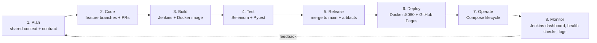

# Student Task Manager — DevOps Lab Project

A framework-free task manager for students (HTML, CSS, JavaScript), built and delivered using the complete **DevOps life cycle**: Git and GitHub for version control, Jenkins for continuous integration, Docker and Docker Compose for containerisation, and Selenium with Pytest for automated browser testing.

**Repository:** https://github.com/vinjamurkaushik-web/student-task-manager

| | |
|---|---|
| **Automated tests** | 16 Selenium end-to-end tests: **16 passed in 34.01 s** |
| **CI** | Jenkins job `Student-Task-Manager-CI`: build #14 **SUCCESS** |
| **Container** | `sohails2409/student-task-manager:latest` (nginx:alpine), served at http://localhost:8080 |
| **Hosting** | GitHub Pages (`github-pages` environment, 8 deployments) |

---

## Table of Contents

1. [Application Features](#application-features)
2. [Technology Stack](#technology-stack)
3. [The DevOps Life Cycle in This Project](#the-devops-life-cycle-in-this-project)
   - [1. Plan](#1-plan)
   - [2. Code](#2-code)
   - [3. Build](#3-build)
   - [4. Test](#4-test)
   - [5. Release](#5-release)
   - [6. Deploy](#6-deploy)
   - [7. Operate](#7-operate)
   - [8. Monitor](#8-monitor)
4. [Quick Start](#quick-start)
5. [Project Structure](#project-structure)
6. [Team Members and Roles](#team-members-and-roles)
7. [Limitations and Future Scope](#limitations-and-future-scope)

---

## Application Features

- Add, complete and delete tasks, each with a category (College, Personal, Work or Other).
- Live statistics: total, completed and pending tasks.
- Dark/light theme, remembered across page reloads.
- Signup, login, logout and protected pages.
- Profile page: edit the display name and change the password.
- Separate task lists for each user (`tasks_<userId>` in localStorage).
- Responsive layout for desktop and mobile.

> **Demo limitation:** accounts, sessions and tasks are stored in the browser's localStorage, and passwords use a simple demonstration hash. This is for a classroom demonstration only. Do not use real credentials.

---

## Technology Stack

| Technology | Category | Purpose in this project |
|---|---|---|
| HTML5, CSS3, JavaScript (vanilla) | Frontend | Four pages, themes and all application logic |
| Browser localStorage | Client storage | Users, session, per-user tasks and theme |
| Git and GitHub | Version control | Feature branches, pull requests and GitHub Pages hosting |
| Jenkins | Continuous integration | Declarative pipeline on a Windows agent (`bat` steps) |
| Docker (nginx:alpine) | Containerisation | Packages the static site into a web-server image |
| Docker Compose | Orchestration | Runs the web, selenium and tests services on one network |
| Selenium (standalone-chrome) | Test automation | Remote Chrome browser driven through WebDriver |
| Python 3.12 and Pytest 8 | Test framework | Test runner, fixtures and assertions |
| Visual Studio Code | Development tool | Editing source files and configuration |

---

## The DevOps Life Cycle in This Project



| # | Phase | What we did | Tools |
|---|---|---|---|
| 1 | **Plan** | Two-phase plan, a work split between three members, and a written contract of IDs, messages and keys | `00 shared context.md`, GitHub |
| 2 | **Code** | Feature-branch workflow, 3 merged pull requests, and an integration branch for phase 2 | Git, GitHub, VS Code |
| 3 | **Build** | Jenkins checks out, validates and archives the project; Docker builds the Nginx image | Jenkins, Docker |
| 4 | **Test** | 16 end-to-end browser tests in containers, all passing | Selenium, Pytest, Docker Compose |
| 5 | **Release** | Pull requests merged to `main`; fingerprinted Jenkins artifacts; a tagged Docker image | GitHub, Jenkins, Docker Hub |
| 6 | **Deploy** | Local container deployment at `localhost:8080`; public static hosting on GitHub Pages | Docker Compose, Nginx, GitHub Pages |
| 7 | **Operate** | Start, stop, inspect and tear down services; per-test browser isolation | Docker Compose, Docker Desktop |
| 8 | **Monitor** | Build status and history, container health checks, logs and a live browser view | Jenkins, Docker, noVNC |

### 1. Plan

**What:** The project was planned in two phases.

| Phase | Dates | Work done |
|---|---|---|
| Phase 1 | September 2026 | Core task app, statistics, categories, dark mode, GitHub Pages, Jenkins pipeline |
| Phase 2 | Late Oct – 1 Nov 2026 | Authentication, Docker, Docker Compose, Selenium suite, extended Jenkinsfile, README |

**How:** For phase 2 the team wrote a shared planning document, `00 shared context.md`, containing a **contract** that every member followed:

- page names (`signup.html`, `login.html`, `index.html`, `profile.html`)
- the HTML element IDs used as Selenium locators (for example `login-email`, `logout-btn`)
- the exact validation messages (for example `Invalid email or password`)
- the localStorage keys (`users`, `currentUserId`, `tasks_<userId>`, `theme`)
- the Docker URLs (`http://web`, `http://selenium:4444/wd/hub`)

Because the contract was fixed in advance, the Selenium tests were written **in parallel** with the authentication code, and the two parts integrated without changes.

### 2. Code

**What:** All code is version-controlled in Git and hosted on GitHub. The team rule was *"One branch per person. Never commit straight to main."*

**How:** Each feature was developed on its own branch and merged through a pull request.

| Branch | Feature | How it was integrated |
|---|---|---|
| `features/stats` | Task statistics, then task categories | PR #1 and PR #3 |
| `feature/dark-mode` | Dark/light theme with persistence | PR #2 |
| `feature/auth` | Signup, login, logout, profile, per-user tasks | Merged into the integration branch |
| `feature/docker-selenium` | Dockerfile, Compose, Selenium suite, Jenkinsfile, README | Base of the integration branch |
| `feature/auth-selenium-integration` | Auth combined with Docker and Selenium (merge commit `ef9e7a6`) | Tested with all 16 tests passing; to be merged to `main` |

```bash
git checkout -b feature/auth                 # create a feature branch
git add auth.js login.html signup.html profile.html
git commit -m "Add user authentication and profile management"
git push -u origin feature/auth              # publish, then open a pull request
```

Code quality practices:
- `escapeHtml()` protects task names against HTML injection.
- Theme flicker is avoided by applying the saved theme before the first paint.
- Small commits use conventional messages, for example `fix: apply saved theme before paint to prevent FOUC`.

### 3. Build

**What:** Every build is automated in two ways: a Jenkins CI pipeline and a Docker image build.

**How – Jenkins (`Jenkinsfile`, declarative pipeline, Windows agent):**

| Stage | Action | Fails when |
|---|---|---|
| Checkout | `checkout scm` from GitHub | The repository cannot be reached |
| Validate | `bat 'if not exist <file> exit /b 1'` for each required file | Any required file is missing |
| Archive | `archiveArtifacts ... fingerprint: true` | No matching files are found |
| Docker Build | `bat 'docker compose build web'` | The image fails to build |
| Selenium Tests | `docker compose --profile test up --build --abort-on-container-exit --exit-code-from tests` | Any test fails |
| Post (always) | `docker compose down` | – |

On `main`, Jenkins runs the Checkout, Validate and Archive stages: **build #14 succeeded in 12 s**. The Docker Build and Selenium Tests stages were added on the integration branch and become active in Jenkins after it is merged to `main`. They also require Docker to be available to the Jenkins agent.

**How – Docker image (`Dockerfile`):**

```dockerfile
FROM nginx:alpine
COPY index.html login.html signup.html profile.html style.css script.js auth.js /usr/share/nginx/html/
EXPOSE 80
```

`.dockerignore` keeps `.git`, `tests/` and the planning notes out of the image. The test runner has its own image (`tests/Dockerfile`, `python:3.12-slim`). Its dependencies are installed before the tests are copied, so that layer is cached between builds.

### 4. Test

**What:** 16 automated **end-to-end** tests drive a real Chrome browser through the application.

**How:**
- Docker Compose starts three services: **web** (the app), **selenium** (Chrome) and **tests** (Pytest).
- **tests** waits until Selenium passes its health check before it runs.
- Each test gets a fresh remote Chrome session, so localStorage starts empty and tests cannot affect each other.
- The tests use explicit waits (`WebDriverWait`) instead of fixed sleeps.

```powershell
docker compose --profile test run --build --rm tests
```

**Results: 16 passed, 0 failed, in 34.01 seconds**

| ID | Scenario | Expected result | Result |
|---|---|---|---|
| TC01 | Signup with valid data | Redirects to the login page | ✅ PASS |
| TC02 | Signup with empty fields | `All fields are required` | ✅ PASS |
| TC03 | Signup with invalid email | `Enter a valid email address` | ✅ PASS |
| TC04 | Signup with short password | `Password must be at least 6 characters` | ✅ PASS |
| TC05 | Signup password mismatch | `Passwords do not match` | ✅ PASS |
| TC06 | Signup duplicate email | `Email already registered` | ✅ PASS |
| TC07 | Login with valid credentials | Task page opens and greeting is visible | ✅ PASS |
| TC08 | Login with wrong password | `Invalid email or password` | ✅ PASS |
| TC09 | Login with unknown email | `Invalid email or password` | ✅ PASS |
| TC10 | Open task page while logged out | Redirects to login | ✅ PASS |
| TC11 | Logout | Returns to login and blocks the task page | ✅ PASS |
| TC12 | Update profile name | `Profile updated`; greeting uses the new name | ✅ PASS |
| TC13 | Change password, then log in | `Password changed`; new password works | ✅ PASS |
| TC14 | Add a task and refresh | Task remains visible | ✅ PASS |
| TC15 | Two users use the app | Each user sees only their own tasks | ✅ PASS |
| TC16 | Toggle theme and refresh | Selected theme remains active | ✅ PASS |

| Test file | Tests | Passed |
|---|---|---|
| `test_signup.py` | TC01–TC06 | 6 / 6 |
| `test_login.py` | TC07–TC11 | 5 / 5 |
| `test_profile.py` | TC12–TC13 | 2 / 2 |
| `test_tasks.py` | TC14–TC16 | 3 / 3 |

### 5. Release

**What:** Code is released by merging reviewed work into `main`, and the build outputs are kept as versioned artifacts.

**How:**

| Pull request | Branch | Content | Merged |
|---|---|---|---|
| #1 | `features/stats` | Task statistics | 6 Sep 2026 |
| #2 | `feature/dark-mode` | Dark/light theme | 10 Sep 2026 |
| #3 | `features/stats` | Task categories | 11 Sep 2026 |

- **Jenkins artifacts:** each successful build archives the project files with MD5 fingerprints. They can be downloaded and traced from the build page.
- **Docker image:** the web image is tagged `sohails2409/student-task-manager:latest` and can be published to Docker Hub:

```powershell
docker login                 # authenticate interactively; never commit tokens
docker compose build web
docker compose push web
```

**Release workflow:** feature branch → verify locally with Docker and Selenium → pull request → merge to `main` → Jenkins build → GitHub Pages republishes.

### 6. Deploy

**What:** The application is deployed in two ways.

| | Local Docker deployment | GitHub Pages |
|---|---|---|
| Runs on | Team member's computer (Docker Desktop) | GitHub's static hosting |
| Web server | Nginx inside the `web` container | GitHub Pages |
| Access | http://localhost:8080 | Public GitHub Pages URL |
| Updated by | `docker compose up --build` | Automatically, on a push to the configured branch |

**How (Docker):**

```powershell
docker compose up --build        # build the image and start the web container
```

- Port mapping `8080:80` forwards host port 8080 to Nginx's port 80 inside the container.
- Only the `web` service starts, because `selenium` and `tests` belong to the `test` profile.
- Add `-d` to run the containers in the background.

### 7. Operate

**What:** The running services are managed with the Docker Compose lifecycle.

| Phase | Command | Effect |
|---|---|---|
| Build | `docker compose build web` | Builds the image, reusing cached layers |
| Start app | `docker compose up --build [-d]` | Starts Nginx on `localhost:8080` |
| Start tests | `docker compose --profile test run --build --rm tests` | Starts web and selenium, waits for health, runs the suite |
| Inspect | `docker ps` / `docker compose ps` / `docker compose logs` | Shows status, health, ports and logs |
| Stop | `Ctrl+C` or `docker compose stop` | Stops the containers |
| Tear down | `docker compose down` | Removes the containers and the network |

**How it is kept reliable:**
- Services find each other by name on a private Compose network, for example `http://web` and `http://selenium:4444/wd/hub`.
- `shm_size: 2gb` stops Chrome crashing inside the container.
- The test container is removed after every run (`--rm`).

### 8. Monitor

**What:** We monitor build health, container health and test behaviour.

**How:**

| What is monitored | Tool | How |
|---|---|---|
| Build status and history | Jenkins dashboard | Status and weather icons, last success (#13), last failure (#3), duration |
| Build details | Jenkins stage view and console output | Per-stage result and time; full log ending in `Finished: SUCCESS` |
| Container health | Docker health check | `curl -f http://localhost:4444/status` every 5 s; `docker ps` shows `(healthy)` |
| Running containers | `docker ps`, Docker Desktop | Uptime, ports (`0.0.0.0:8080->80/tcp`) and status |
| Application and Selenium logs | `docker compose logs` | Nginx access and error logs; Selenium Grid logs |
| Test behaviour | Pytest `-vv -rA` and the noVNC viewer | Live PASS/FAIL per test; watch Chrome at http://localhost:7900 |

**Problems found through monitoring, and how we fixed them:**

| Problem | Fix |
|---|---|
| Jenkins build #3 failed: a byte-order mark (BOM) at the start of the Jenkinsfile | Commits "Fix Jenkins pipeline" and "Fix Jenkins pipeline BOM"; every later build succeeded |
| Tests started before Chrome was ready | Health check plus `depends_on: condition: service_healthy` |
| Timing-dependent test failures | `WebDriverWait` explicit waits instead of sleeps |
| `crypto.subtle` unavailable at `http://web` (not a secure context) | Demonstration FNV-1a hash, clearly documented as not secure |
| Theme flickered from light to dark on load | Inline script applies the saved theme before the first paint |

---

## Quick Start

**Prerequisites:** Docker Desktop (running) and Git.

```powershell
git clone https://github.com/vinjamurkaushik-web/student-task-manager.git
cd student-task-manager

docker compose up --build                               # app at http://localhost:8080
docker compose --profile test run --build --rm tests    # run the 16 Selenium tests
docker compose down                                     # clean up
```

Without Docker, you can open `signup.html` directly in a browser.

---

## Project Structure

```text
student-task-manager/
├── index.html              # Task dashboard (protected)
├── login.html              # Login page
├── signup.html             # Account creation page
├── profile.html            # Profile and password page (protected)
├── style.css               # Shared styles, light/dark themes, responsive rules
├── script.js               # Task operations, statistics, theme toggle
├── auth.js                 # Browser-side authentication logic
├── Dockerfile              # nginx:alpine image for the static site
├── .dockerignore           # Files excluded from the web image
├── docker-compose.yml      # web, selenium and tests services
├── Jenkinsfile             # Declarative CI pipeline (Windows agent)
├── tests/
│   ├── Dockerfile          # python:3.12-slim test-runner image
│   ├── requirements.txt    # pytest and selenium
│   ├── conftest.py         # Remote browser fixture and helpers
│   ├── test_signup.py      # TC01–TC06
│   ├── test_login.py       # TC07–TC11
│   ├── test_profile.py     # TC12–TC13
│   └── test_tasks.py       # TC14–TC16
└── README.md               # This guide
```

---

## Team Members and Roles

| Member | Roll No. | Responsibilities | DevOps phases covered |
|---|---|---|---|
| Vinjamur Kaushik | 24261A05C6 | Initial project setup, Jenkins job and pipeline fixes, project report, documentation and evidence | Build, Release, Monitor |
| Perumandla Tejashwin | 24261A05A8 | Task statistics and categories, authentication (signup, login, logout), profile and password change | Code, Release |
| Mohammed Sohail | 24261A05A0 | Dark mode, Dockerfile and Docker Compose, Selenium test suite, Jenkins pipeline extensions, branch integration, README | Code, Build, Test, Deploy, Operate |

**Guide:** K. Sunitha, Faculty In-charge, Department of CSE, Mahatma Gandhi Institute of Technology.

---

## Limitations and Future Scope

| Limitation today | Planned improvement |
|---|---|
| Client-side authentication with a demonstration hash | Backend authentication with bcrypt or Argon2 over HTTPS |
| Data only in one browser's localStorage | Database such as PostgreSQL or MongoDB |
| Jenkins on `main` runs Checkout, Validate and Archive only | Merge the extended Jenkinsfile, publish JUnit reports, trigger builds from GitHub webhooks |
| Local Docker deployment only | Deploy the image to a cloud platform or Kubernetes |
| Basic monitoring | Web health check, Prometheus and Grafana, centralised logs, build notifications |
| Chrome only, one machine | Cross-browser Selenium Grid (Firefox, Edge) and accessibility tests |
